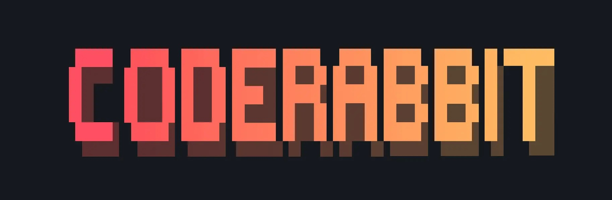

Thank you [CodeRabbit](https://www.coderabbit.ai/?ref=app-ideas) for sponsoring this repository! 🙏

# :ledger: App Ideas Collection

Have you ever wanted to build something but you had no idea what to do? Just as
authors sometimes have "writers block" it's also true for developers. This list is intended to solve this issue once and for all! 👍

These applications are:

-   great for improving your coding skills :muscle:;
-   great for experimenting with new technologies 🆕;
-   great for adding to your portfolio to impress your next employer/client :file_folder:;
-   great for using as examples in tutorials (articles or videos) :page_with_curl:;
-   easy to complete and also easily extendable with new features :ok_hand:;

This is not just a simple list of projects, but a collection that describes each project in enough detail so that you can develop it from the ground up!

Each project has the following **features**:

1. A clear and descriptive objective;
2. A list of _User Stories_ which should be implemented (these stories act more as a guideline than a forced list of _To-Do's_. Feel free to add your own stories if you want);
3. A list of bonus features that not only improve the base project, but also your skills at the same time (these are optional and should be attempted only after you have completed the required user stories)
4. All the resources and links to help you find what you need to complete the project

Here you can [watch a video about this repository](https://www.youtube.com/watch?v=TNzCfgwIDCY).

## Projects

Projects are divided into three tiers based on the knowledge and experience
required to complete them.

| Tier | Developer Profile                                                                                                                                                |
| :--: | ---------------------------------------------------------------------------------------------------------------------------------------------------------------- |
|  1   | Developers in the early stages of their learning journey. Those who are typically focused on creating user-facing applications.                                  |
|  2   | Developers at an intermediate stage of learning and experience. They are comfortable in UI/UX, using development tools, and building apps that use API services. |
|  3   | Developers who have all of the above, and are learning more advanced techniques like implementing backend applications and database services.                    |

🌟 - New Project

### Tier-1: Beginner Projects

| Name                                                                              | Short Description                                          | Tier       |
| --------------------------------------------------------------------------------- | ---------------------------------------------------------- | ---------- |
| [Bin2Dec](./Projects/1-Beginner/Bin2Dec-App.md)                                   | Binary-to-Decimal number converter                         | 1-Beginner |
| [Border Radius Previewer](./Projects/1-Beginner/Border-Radius-Previewer.md)       | Preview how CSS3 border-radius values affect an element    | 1-Beginner |
| [Calculator](./Projects/1-Beginner/Calculator-App.md)                             | Calculator                                                 | 1-Beginner |
| [Christmas Lights](./Projects/1-Beginner/Christmas-Lights-App.md)                 | Simulate a string of Christmas lights                      | 1-Beginner |
| [Cause Effect App](./Projects/1-Beginner/Cause-Effect-App.md)                     | Click list item to display item details                    | 1-Beginner |
| [Color Cycle](./Projects/1-Beginner/Color-Cycle-App.md)                           | Cycle a color value through incremental changes            | 1-Beginner |
| [Countdown Timer](./Projects/1-Beginner/Countdown-Timer-App.md)                   | Event Countdown timer                                      | 1-Beginner |
| [CSV2JSON App](./Projects/1-Beginner/CSV2JSON-App.md)                             | CSV to JSON converter                                      | 1-Beginner |
| [Dollars to Cents](./Projects/1-Beginner/Dollars-To-Cents-App.md)                 | Convert dollars to cents                                   | 1-Beginner |
| [Dynamic CSS Variables](./Projects/1-Beginner/Dynamic-CSSVar-app.md)              | Dynamically change CSS variable settings                   | 1-Beginner |
| [First DB App](./Projects/1-Beginner/First-DB-App.md)                             | Your first Database app!                                   | 1-Beginner |
| [Flip Image](./Projects/1-Beginner/Flip-Image-App.md)                             | Change the orientation of images across two axes           | 1-Beginner |
| [GitHub Status](./Projects/1-Beginner/GitHub-Status-App.md)                       | Display Current GitHub Status                              | 1-Beginner |
| [Hello](./Projects/1-Beginner/Hello-App.md)                                       | User native language greeting                              | 1-Beginner |
| [IOT Mailbox Simulator](./Projects/1-Beginner/IOT-Mailbox-App.md)                 | Use callbacks to check your snail mail                     | 1-Beginner |
| [JS Input Validation](./Projects/1-Beginner/Javascript-Validation-With-Regex.md)  | Script to validate inputs entered by a user using RegEx    | 1-Beginner |
| [JSON2CSV App](./Projects/1-Beginner/JSON2CSV-App.md)                             | JSON to CSV converter                                      | 1-Beginner |
| [Key Value](./Projects/1-Beginner/Key-Value-App.md)                               | Keyboard Event Values                                      | 1-Beginner |
| [Lorem Ipsum Generator](./Projects/1-Beginner/Lorem-Ipsum-Generator.md)           | Generate lorem ipsum placeholder text                      | 1-Beginner |
| [Notes App](./Projects/1-Beginner/Notes-App.md)                                   | Create an online note pad                                  | 1-Beginner |
| [Pearson Regression](./Projects/1-Beginner/Pearson-Regression-App.md)             | Calculate the correlation coefficient for two sets of data | 1-Beginner |
| [Pomodoro Clock](./Projects/1-Beginner/Pomodoro-Clock.md)                         | Task timer to aid personal productivity                    | 1-Beginner |
| [Product Landing Page](./Projects/1-Beginner/Product-Landing-Page.md)             | Showcase product details for possible buyers               | 1-Beginner |
| [Quiz App](./Projects/1-Beginner/Quiz-App.md)                                     | Test your knowledge by answering questions                 | 1-Beginner |
| [Recipe App](./Projects/1-Beginner/Recipe-App.md)                                 | Recipe                                                     | 1-Beginner |
| [Random Meal Generator](./Projects/1-Beginner/Random-Meal-Generator.md)           | Generate random meals                                      | 1-Beginner |
| [Random Number Generator](./Projects/1-Beginner/Random-Number-Generator.md)       | Generate random number between range.                      | 1-Beginner |
| [Roman to Decimal Converter](./Projects/1-Beginner/Roman-to-Decimal-Converter.md) | Convert Roman to Decimal numbers                           | 1-Beginner |
| [Slider Design](./Projects/1-Beginner/Slider-Design.md)                           | Display images using a slider control                      | 1-Beginner |
| [Stopwatch App](./Projects/1-Beginner/Stopwatch-App.md)                           | Count time spent on activities                             | 1-Beginner |
| [TrueOrFalse](./Projects/1-Beginner/True-or-False-App.md)                         | Identify the result of a conditional comparison            | 1-Beginner |
| [Vigenere Cipher](./Projects/1-Beginner/Vigenere-Cipher.md)                       | Encrypt text using the Vigenere Cypher                     | 1-Beginner |
| [Wind Chill](./Projects/1-Beginner/Windchill-App.md)                              | Calculate the windchill factor from an actual temperature  | 1-Beginner |
| [Word Frequency](./Projects/1-Beginner/Word-Frequency-App.md)                     | Calculate word frequency in a block of text                | 1-Beginner |
| [Weather App](./Projects/1-Beginner/Weather-App.md)                               | Get the temperature, weather condition of a city.          | 1-Beginner |

### Tier-2: Intermediate Projects

| Name                                                                              | Short Description                                  | Tier           |
| --------------------------------------------------------------------------------- | -------------------------------------------------- | -------------- |
| [Bit Masks](./Projects/2-Intermediate/Bit-Masks-App.md)                           | Using Bit Masks for Conditions                     | 2-Intermediate |
| [Book Finder App](./Projects/2-Intermediate/Book-Finder-App.md)                   | Search for books by multiple criteria              | 2-Intermediate |
| [Calculator CLI](./Projects/2-Intermediate/Calculator-CLI.md)                     | Create a basic calculator cli.                     | 2-Intermediate |
| [Card Memory Game](./Projects/2-Intermediate/Card-Memory-Game.md)                 | Memorize and match hidden images                   | 2-Intermediate |
| [Charity Finder App](./Projects/2-Intermediate/Charity-Finder-App.md)             | Find a Global Charity to donate to                 | 2-Intermediate |
| [Chrome Theme Extension](./Projects/2-Intermediate/Chrome-Theme-Extension.md)     | Build your own chrome theme extention.             | 2-Intermediate |
| [Currency Converter](./Projects/2-Intermediate/Currency-Converter.md)             | Convert one currency to another.                   | 2-Intermediate |
| [Drawing App](./Projects/2-Intermediate/Drawing-App.md)                           | Create digital artwork on the web                  | 2-Intermediate |
| [Emoji Translator App](./Projects/2-Intermediate/Emoji-Translator-App.md)         | Translate sentences into Emoji                     | 2-Intermediate |
| [Flashcards App](./Projects/2-Intermediate/FlashCards-App.md)                     | Review and test your knowledge through Flash Cards | 2-Intermediate |
| [Flip Art App](./Projects/2-Intermediate/Flip-Art-App.md)                         | Animate a set of images                            | 2-Intermediate |
| [Game Suggestion App](./Projects/2-Intermediate/Game-Suggestion-App.md)           | Create polls to decide what games to play          | 2-Intermediate |
| [GitHub Profiles](./Projects/2-Intermediate/GitHub-Profiles.md)                   | A GitHub user search App                           | 2-Intermediate |
| [HighStriker Game](./Projects/2-Intermediate/HighStriker-Game.md)                 | Highstriker strongman carnival game                | 2-Intermediate |
| [Image Scanner](./Projects/2-Intermediate/Image-Scaner.md)                        | Image Scanner App                                  | 2-Intermediate |
| [Markdown Previewer](./Projects/2-Intermediate/Markdown-Previewer.md)             | Preview text formatted in GitHub flavored markdown | 2-Intermediate |
| [Markdown Table Generator](./Projects/2-Intermediate/Markdown-Table-Generator.md) | Convert a table into Markdown-formatted text       | 2-Intermediate |
| [Math Editor](./Projects/2-Intermediate/math-editor.md)                           | A math editor for students to use                  | 2-Intermediate |
| [Meme Generator App](./Projects/2-Intermediate/Meme-Generator-App.md)             | Create custom memes                                | 2-Intermediate |
| [Name Generation using RNNs](./Projects/2-Intermediate/Name-Generator.md)         | Generate names using names dataset                 | 2-Intermediate |
| [Password Generator](./Projects/2-Intermediate/Password-Generator.md)             | Generate random passwords                          | 2-Intermediate |
| [Podcast Directory](./Projects/2-Intermediate/Podcast-Directory-App.md)           | Directory of favorite podcasts                     | 2-Intermediate |
| [QR Code Badge Generator](./Projects/2-Intermediate/QRCode-Badge-App.md)          | Encode badge info in a QRcode                      | 2-Intermediate |
| [Regular Expression Helper](./Projects/2-Intermediate/RegExp-Helper-App.md)       | Test Regular Expressions                           | 2-Intermediate |
| [Sales Reciepts App](./Projects/2-Intermediate/Sales-DB-App.md)                   | Record Sales Receipts in a DB                      | 2-Intermediate |
| [Simple Online Store](./Projects/2-Intermediate/Simple-Online-Store.md)           | Simple Online Store                                | 2-Intermediate |
| [Sports Bracket Generator](./Projects/2-Intermediate/Sports-Bracket-Generator.md) | Generate a sports bracket diagram                  | 2-Intermediate |
| [String Art](./Projects/2-Intermediate/String-Art.md)                             | An animation of moving, colored strings            | 2-Intermediate |
| [This or That Game](./Projects/2-Intermediate/This-or-That-Game.md)               | This or That Game                                  | 2-Intermediate |
| [Timezone Slackbot](./Projects/2-Intermediate/Timezone-Slackbot.md)               | Display Team Timezones                             | 2-Intermediate |
| [To-Do App](./Projects/2-Intermediate/To-Do-App.md)                               | Manage personal to-do tasks                        | 2-Intermediate |
| [Typing Practice](./Projects/2-Intermediate/Typing-Practice-App.md)               | Typing Practice                                    | 2-Intermediate |
| [Voting App](./Projects/2-Intermediate/Voting-App.md)                             | Voting App                                         | 2-Intermediate |

### Tier-3: Advanced Projects

| Name                                                                          | Short Description                                                   | Tier       |
| ----------------------------------------------------------------------------- | ------------------------------------------------------------------- | ---------- |
| [Battleship Bot](./Projects/3-Advanced/Battleship-Bot.md)                     | Create a Discord bot that plays Battleship                          | 3-Advanced |
| [Battleship Game Engine](./Projects/3-Advanced/Battleship-Game-Engine.md)     | Create a callable engine to play the Battleship game                | 3-Advanced |
| [Boole Bots Game](./Projects/3-Advanced/Boole-Bot-Game.md)                    | Battling Bots driven by Boolean algebra                             | 3-Advanced |
| [Calendar](./Projects/1-Beginner/Calendar-App.md)                             | Create your own Calendar                                            | 3-Advanced |
| [Calorie Counter](./Projects/3-Advanced/Calorie-Counter-App.md)               | Calorie Counter Nutrition App                                       | 3-Advanced |
| [Chat App](./Projects/3-Advanced/Chat-App.md)                                 | Real-time chat interface                                            | 3-Advanced |
| [Contribution Tracker App](./Projects/3-Advanced/Contribution-Tracker-App.md) | Track funds donated to charity                                      | 3-Advanced |
| [Elevator](./Projects/3-Advanced/Elevator-App.md)                             | Elevator simulator                                                  | 3-Advanced |
| [Fast Food Simulator](./Projects/3-Advanced/FastFood-App.md)                  | Fast Food Restaurant Simulator                                      | 3-Advanced |
| [Instagram Clone](./Projects/3-Advanced/Instagram-Clone-App.md)               | A clone of Facebook's Instagram app                                 | 3-Advanced |
| [GitHub Timeline](./Projects/3-Advanced/GitHub-Timeline-App.md)               | Generate a timeline of a users GitHub Repos                         | 3-Advanced |
| [Kudos Slackbot](./Projects/3-Advanced/Kudos-Slackbot.md)                     | Give recognition to a deserving peer                                | 3-Advanced |
| [Movie App](./Projects/3-Advanced/Movie-App.md)                               | Browse, Find Ratings, Check Actors and Find you next movie to watch | 3-Advanced |
| [MyPodcast Library](./Projects/3-Advanced/MyPodcast-Library-app.md)           | Create a library of favorite podcasts                               | 3-Advanced |
| [NASA Exoplanet Query](./Projects/3-Advanced/NASA-Exoplanet-Query.md)         | Query NASA's Exoplanet Archive                                      | 3-Advanced |
| [Shell Game](./Projects/3-Advanced/Shell-Game.md)                             | Animated shell game                                                 | 3-Advanced |
| [Shuffle Deck](./Projects/3-Advanced/Shuffle-Deck-App.md)                     | Evaluate different algorithms for shuffling a card deck             | 3-Advanced |
| [Slack Archiver](./Projects/3-Advanced/Slack-Archiver.md)                     | Archive Slack Messages                                              | 3-Advanced |
| [Spell-It App](./Projects/3-Advanced/SpellIt-App.md)                          | A twist on the classic Speak N Spell game                           | 3-Advanced |
| [Survey App](./Projects/3-Advanced/Survey-App.md)                             | Define, conduct, and view a survey                                  | 3-Advanced |

## Plans for the future

We are planning to add more and more projects to this repository. For this, we need your help! Find out how to contribute below. 👇

We are also planning to create a website where you can easily browse through all of the projects.

## Contribution

Any contributions are highly appreciated. :pray: You can contribute in two ways:

1. create an issue and tell us your idea :bulb:. Make sure that you use the **new idea** label in this case;
2. fork the project and submit a PR with your new idea. Before doing that, please make sure that you read and follow the [Contribution Guide](./CONTRIBUTING.md);

### Examples

You can also add your own examples to the projects after you have completed them. I highly encourage you to do this as it will show others what amazing things were built! 👍

## Spread the word!

If the information from this repo was useful to you in any way, make sure you give it a star 🌟, this way others can find it and benefit too! Together we can grow and make our community better! :smiley:

Do you have any suggestions on how we could improve this project overall? Let us know! We'd love to hear your feedback!

### Main Contributors 🙂🙂

-   **Florin Pop**: [Twitter](https://twitter.com/florinpop1705) - [YouTube Channel](https://youtube.com/florinpop) - [website](https://florin-pop.com).
-   **Jim Medlock**: [Twitter](https://twitter.com/jd_medlock) - [articles](https://medium.com/@jdmedlock)

## 100Days100Projects 🚀

As a bonus, I created the [#100Days100Projects challenge](https://www.florin-pop.com/blog/2019/09/100-days-100-projects). You can find in there 100 more ideas of smaller projects. Enjoy! 😄

## Stars history

## 🌐 Web Resources & Interactive Index
- [CATEGORY QUIZ](https://theskillquest.pages.dev/category-quiz.html)
- [SORT WATER NOW](https://themindplays.pages.dev/sort-water-now.html)
- [ITALIAN BRAINROT JIGSAW](https://themindzone.pages.dev/italian-brainrot-jigsaw.html)
- [PAINT RACE](https://thequizzone.pages.dev/paint-race.html)
- [100 DOORS CHALLENGE](https://theskillquest.pages.dev/100-doors-challenge.html)
- [VEGA MIX SEA ADVENTURES](https://theskillquest.pages.dev/vega-mix-sea-adventures.html)
- [CONNECT CLUES THE MISSING PROFESSOR](https://quizverses.pages.dev/connect-clues-the-missing-professor.html)
- [UPSIDE DOWN](https://iskillquest.pages.dev/upside-down.html)
- [LORENZO THE RUNNER](https://iskillquest.pages.dev/lorenzo-the-runner.html)
- [ZOMBIE SPACE EPISODE II](https://thelearnquesters.pages.dev/zombie-space-episode-ii.html)
- [DINO SHOOTER PRO](https://quizverses.github.io/dino-shooter-pro.html)
- [SCHOOL ESCAPE OBBIE RUN](https://quizverses-9d2f2.web.app/school-escape-obbie-run.html)
- [GTA GRAND VEGAS CRIME](https://themindplaying.web.app/gta-grand-vegas-crime.html)
- [CATEGORY SOCCER60](https://theskillquest.pages.dev/category-soccer60.html)
- [FAMILY IDLE FARM BUILD HARVEST](https://studyquests.github.io/family-idle-farm-build-harvest.html)
- [PIZZA PUZZLE](https://theskillquest.pages.dev/pizza-puzzle.html)
- [UFO ATTACK](https://quizverses-9d2f2.web.app/ufo-attack.html)
- [CATEGORY FIGHTING124](https://studyquesthub.web.app/category-fighting124.html)
- [MERGE CUBES 2048 3D](https://learnquester.github.io/merge-cubes-2048-3d.html)
- [SPRING TILE MASTER](https://studyplaying.github.io/spring-tile-master.html)
- [BLOCK CRAFT 3D SCHOOL](https://iskillquest.pages.dev/block-craft-3d-school.html)
- [BLOCK SNIPER](https://themindzone.pages.dev/block-sniper.html)
- [SPACE SURVIVAL RAINBOW FRIENDS MONSTER](https://learnquester.pages.dev/space-survival-rainbow-friends-monster.html)
- [BOWLING STARS](https://learnquester.github.io/bowling-stars.html)
- [DAILY CHESS PUZZLE](https://ptskillcrafts.pages.dev/daily-chess-puzzle.html)
- [DIRTY MONEY THE RICH GET RICH](https://quizverses-9d2f2.web.app/dirty-money-the-rich-get-rich.html)
- [CODE RUNNER BINARY CONFUSION](https://iskillquest.pages.dev/code-runner-binary-confusion.html)
- [2048 MAYHEMIO](https://learnquester.github.io/2048-mayhemio.html)
- [ATLANTIC SKY HUNTER XTREME](https://learnquester.github.io/atlantic-sky-hunter-xtreme.html)
- [CATEGORY SOCCER 3](https://quizverses.github.io/category-soccer-3.html)
- [BUBBLE RUSH](https://themindplaying.web.app/bubble-rush.html)
- [SPRUNKI POPIT](https://themindplays.pages.dev/sprunki-popit.html)
- [CLEAN HOUSE CLEARING TRASH AND DIRT](https://iskillquest.pages.dev/clean-house-clearing-trash-and-dirt.html)
- [BUBBLE IT JAM](https://studyplayings.web.app/bubble-it-jam.html)
- [HOARD MASTER ONLINE](https://themindplaying.web.app/hoard-master-online.html)
- [SNOW ROAD PUZZLE](https://learnquesters.pages.dev/snow-road-puzzle.html)
- [CATEGORY MMO24](https://quizverses.github.io/category-mmo24.html)
- [BUNNYHOP AND SURF MAPS](https://studyquesthub.web.app/bunnyhop-and-surf-maps.html)
- [MEME CHALLENGEIO](https://iskillquest.pages.dev/meme-challengeio.html)
- [SEA BATTLE ADMIRAL](https://studyplaying.github.io/sea-battle-admiral.html)
- [CATEGORY ANIMAL](https://studyquesthub.web.app/category-animal.html)
- [COP RUN 3D](https://themindplay.pages.dev/cop-run-3d.html)
- [ZOMBIE RAFT](https://studyquests.pages.dev/zombie-raft.html)
- [INDEX15](https://studyquesthub.web.app/index15.html)
- [TAP 3D BLOCKS](https://thequizzone.pages.dev/tap-3d-blocks.html)
- [CRAFTY TOWN MERGE CITY](https://studyplaying.github.io/crafty-town-merge-city.html)
- [ROTATE RINGS CIRCLE PUZZLE](https://studyplaying.github.io/rotate-rings-circle-puzzle.html)
- [PATH ICE](https://iskillquest.pages.dev/path-ice.html)
- [ROYAL JEWELS MATCH](https://themindplaying.web.app/royal-jewels-match.html)
- [CATEGORY DRAWING GAMES](https://studyplayings.pages.dev/category-drawing-games.html)
- [FARM OF WORDS](https://studyplaying.github.io/farm-of-words.html)
- [BOAT MANIA](https://thequizzone.pages.dev/boat-mania.html)
- [SORTSTORE](https://themindplay.pages.dev/sortstore.html)
- [CATEGORY BATTLE524](https://studyplayings.web.app/category-battle524.html)
- [MERGE FUSION](https://themindplay.github.io/merge-fusion.html)
- [SUPERHEROES AND THE WAND](https://studyquesthub.web.app/superheroes-and-the-wand.html)
- [CATEGORY PARKOUR55](https://learnquester.pages.dev/category-parkour55.html)
- [TRAFFIC RACING](https://themindplaying.web.app/traffic-racing.html)
- [PUT THE FRUIT TOGETHER](https://theskillquest.pages.dev/put-the-fruit-together.html)
- [CAR PARKING MASTER 3D REAL DRIVING SIMULATOR](https://thequizzone.pages.dev/car-parking-master-3d-real-driving-simulator.html)
- [CATEGORY COLLECT600](https://thelearnquesters.pages.dev/category-collect600.html)
- [DRAW TO KILL](https://quizverses-9d2f2.web.app/draw-to-kill.html)
- [CATEGORY STRATEGY](https://learnquester.pages.dev/category-strategy.html)
- [UNPUZZLE MASTER](https://themindplays.pages.dev/unpuzzle-master.html)
- [CARS MERGE](https://thequizzone.pages.dev/cars-merge.html)
- [FOOD TRUCK CHEF COOKING](https://studyquests.github.io/food-truck-chef-cooking.html)
- [FRUIT BLOCK TETRA PUZZLE](https://themindplay.github.io/fruit-block-tetra-puzzle.html)
- [TURRET GUNNER](https://quizverses.github.io/turret-gunner.html)
- [CATEGORY DESTROY256](https://learnquesters.pages.dev/category-destroy256.html)
- [CATEGORY SOCCER 2](https://quizverses.github.io/category-soccer-2.html)
- [MAZE ESCAPE CRAFT MAN](https://thelearnquester.web.app/maze-escape-craft-man.html)
- [HYPER WAVE CHALLENGE](https://themindplays.pages.dev/hyper-wave-challenge.html)
- [CATEGORY TOP DOWN251](https://quizverses-9d2f2.web.app/category-top-down251.html)
- [GYM SIMULATOR TYCOON](https://thequizzone.pages.dev/gym-simulator-tycoon.html)
- [RUSH CAR DRIVING RACE MASTER](https://quizverses-9d2f2.web.app/rush-car-driving-race-master.html)
- [STICKMAN GUNNER](https://studyquesthub.web.app/stickman-gunner.html)
- [HIDDEN OBJECTS](https://thelearnquester.web.app/hidden-objects.html)
- [JUMPER](https://iskillquest.pages.dev/jumper.html)
- [THE OFFICE ESCAPE](https://iskillquest.pages.dev/the-office-escape.html)
- [LOL SURPRISE OMG BB DRIVER](https://thequizzone.pages.dev/lol-surprise-omg-bb-driver.html)
- [ZOMBIE HORDE BUILD SURVIVE](https://thequizzone.pages.dev/zombie-horde-build-survive.html)
- [CATEGORY MEDIEVAL15](https://studyplaying.github.io/category-medieval15.html)
- [COLLECT HONEY PUZZLE](https://thelearnquester.web.app/collect-honey-puzzle.html)
- [CATEGORY 1 PLAYER139](https://quizverses-9d2f2.web.app/category-1-player139.html)
- [INDEX20](https://quizverses.pages.dev/index20.html)
- [CARS VS ZOMBIES](https://studyquesthub.web.app/cars-vs-zombies.html)
- [ROAD OF FURY 4](https://learnquester.pages.dev/road-of-fury-4.html)
- [PICKLE BALL CLASH](https://thelearnquesters.pages.dev/pickle-ball-clash.html)
- [STARRY STYLE DORAMA OF DREAM](https://thequizzone.pages.dev/starry-style-dorama-of-dream.html)
- [CROWD BATTLE GUN RUSH](https://themindplay.pages.dev/crowd-battle-gun-rush.html)
- [SWEEPER CURLING](https://studyplaying.github.io/sweeper-curling.html)
- [DUNGEON MASTER KNIGHT](https://theskillquest.pages.dev/dungeon-master-knight.html)
- [CATEGORY BOARDGAMES](https://thequizzone.pages.dev/category-boardgames.html)
- [HORSEBACK SURVIVAL](https://themindplay.pages.dev/horseback-survival.html)
- [CLASSIC MAHJONG](https://themindplaying.web.app/classic-mahjong.html)
- [TRICKY SHOTS](https://themindplay.pages.dev/tricky-shots.html)
- [TRI PEAKS EMERLAND SOLITAIRE](https://quizverses-9d2f2.web.app/tri-peaks-emerland-solitaire.html)
- [SNIPING ALIENS](https://themindplays.pages.dev/sniping-aliens.html)
- [INDEX5](https://themindplays.pages.dev/index5.html)
- [DTA BEST THIEF](https://theskillquest.pages.dev/dta-best-thief.html)
- [INDEX16](https://themindplay.pages.dev/index16.html)
- [SPRUNKI GARDEN](https://theskillquest.pages.dev/sprunki-garden.html)
- [STICKMAN FIGHT PRO](https://theskillquest.pages.dev/stickman-fight-pro.html)
- [HIDDEN OBJECTS ISLAND](https://studyplayings.web.app/hidden-objects-island.html)
- [BUILD A ROLLERCOASTER SIMULATOR](https://themindzone.pages.dev/build-a-rollercoaster-simulator.html)
- [JUICY MATCH](https://studyquesthub.web.app/juicy-match.html)
- [RED STICKMAN VS CRAFTMANS 2](https://studyquests.github.io/red-stickman-vs-craftmans-2.html)
- [BROTHERFOLLOW ME MERGE MEN](https://studyquesthub.web.app/brotherfollow-me-merge-men.html)
- [SKATING PARK](https://studyquests.github.io/skating-park.html)
- [CATEGORY CLASSIC98](https://themindzone.pages.dev/category-classic98.html)
- [HIDDEN OBJECT EMILYS CASE](https://theskillquest.pages.dev/hidden-object-emilys-case.html)
- [CATEGORY SIMULATION 2](https://themindplay.pages.dev/category-simulation-2.html)
- [STICKMAN BRAWLER](https://themindplaying.web.app/stickman-brawler.html)
- [VOID ORBIT](https://thelearnquesters.pages.dev/void-orbit.html)
- [MY CASTLE MERGE STORY](https://thelearnquesters.pages.dev/my-castle-merge-story.html)
- [DOGGO JUMP](https://theskillquest.pages.dev/doggo-jump.html)
- [SLOPE EMOJI 2](https://themindzone.pages.dev/slope-emoji-2.html)
- [CONNECT EM ALL](https://thelearnquester.web.app/connect-em-all.html)
- [FORMULA TRAFFIC RACER](https://thequizzone.pages.dev/formula-traffic-racer.html)
- [IMAGE CROSSWORD](https://quizverses-9d2f2.web.app/image-crossword.html)
- [LABUBU MERGE CLICKER](https://iskillquest.pages.dev/labubu-merge-clicker.html)
- [CAKE LINK MASTER](https://studyplayings.web.app/cake-link-master.html)
- [CATEGORY ART](https://studyplayings.web.app/category-art.html)
- [BALLERINA CAPPUCCINA FIRST DATE](https://themindzone.pages.dev/ballerina-cappuccina-first-date.html)
- [DIGWORM IO](https://studyquesthub.web.app/digworm-io.html)
- [INDEX9](https://skillplay.github.io/index9.html)
- [BEACH CLUB](https://thelearnquesters.pages.dev/beach-club.html)
- [STAND ON THE RIGHT COLOR ROBBY](https://learnquesters.pages.dev/stand-on-the-right-color-robby.html)
- [MATCH MASTERS](https://learnquester.pages.dev/match-masters.html)
- [CATEGORY PIXEL313](https://studyplayings.pages.dev/category-pixel313.html)
